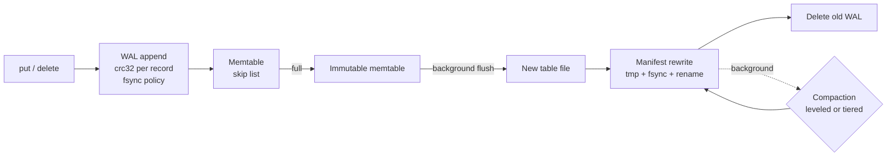
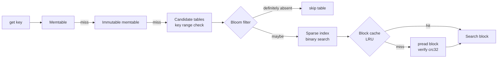

# lsm-kv-store

A log-structured merge-tree (LSM-tree) key-value storage engine, written from
scratch in Python 3.12 with no runtime dependencies. It has a write-ahead log
with crash recovery, a skip-list memtable, immutable sorted table files with
Bloom filters, an LRU block cache, and two compaction strategies (leveled and
size-tiered) that run on a background thread.

## The problem

A storage engine has to be good at three things that pull against each other:

- **Writes.** Updating data in place on disk means random I/O, which is slow.
- **Reads.** A lookup should touch as few places on disk as possible.
- **Space.** Old versions and deleted keys should not pile up forever.

An LSM-tree makes writes cheap by never updating anything in place. Each write
goes to an append-only log and to a sorted in-memory table. When that table is
full, it is written out once, in order, as an immutable file. The cost moves to
the background: files accumulate, so reads may have to check several of them,
and stale versions take space until **compaction** merges files and throws the
old versions away. How you compact decides where you land between write cost,
read cost, and space cost. This project implements both common answers and
measures the difference.

## Architecture

### Write path



1. The record is appended to the write-ahead log (WAL). Each record carries a
   crc32 of its length and a crc32 of its payload.
2. The entry goes into the memtable, a skip list ordered by key. Each entry has
   a sequence number; a higher number is newer. A delete writes a tombstone.
3. When the memtable reaches `memtable_bytes`, it becomes immutable and a new
   memtable and WAL take over. Writers keep going.
4. The background thread writes the immutable memtable to a table file, records
   it in the manifest, and deletes the WAL that is no longer needed.
5. The same thread runs compactions when the strategy asks for one.

### Read path



A scan does the same across all sources at once: a k-way merge of the memtable,
the immutable memtable, and every overlapping table, which yields the newest
version of each key and hides tombstones.

### Table file layout

```
data block 0 | data block 1 | ... | index | bloom filter | meta | footer
```

- **Data blocks** (default 4 KiB) hold entries in key order, each block followed
  by a crc32.
- **Index** is sparse: one entry per block (first key, offset, size). A lookup
  binary-searches it and reads exactly one block.
- **Bloom filter** is sized from the target false-positive rate:
  `bits/key = -ln(p) / ln(2)^2`, `hashes = bits/key * ln(2)`. It uses double
  hashing over one blake2b digest.
- **Meta** stores entry and tombstone counts, the sequence number range, and the
  largest key.
- **Footer** has a fixed size, points at the other sections, and has its own
  crc32 and a magic number.

### Compaction strategies

- **Leveled** (`compaction="leveled"`). Flushed tables land in L0, where they can
  overlap. When L0 has 4 tables, they all merge with the overlapping part of L1.
  From L1 down, files in a level never overlap and each level may hold 10 times
  more than the one above. When a level is over budget, one file (chosen
  round-robin through the key space) merges into the next level. If nothing
  overlaps, the file just moves down without a rewrite. Writers stall when L0
  reaches 12 tables, so reads cannot fall far behind.
- **Size-tiered** (`compaction="tiered"`). Every table is a sorted run. Runs are
  grouped into buckets of similar size (0.5x to 1.5x of the bucket average).
  When a bucket holds 4 runs, they merge into one larger run.

Because tiered runs overlap and a merged run can hold both old and new data, a
point read does not trust file order. It checks candidate tables newest-first by
their largest sequence number, keeps the entry with the highest sequence number,
and skips any table whose largest sequence number is lower than what it has
already found. Leveled reads also stop at the first level that has the key.

A tombstone is dropped during compaction only when no table outside the
compaction might hold an older version of that key (checked by key range and
smallest sequence number). Otherwise the deleted value would come back.

### Durability and recovery

- **WAL sync policy** (`wal_sync`): `always` fsyncs every write, `batch` fsyncs
  every `wal_batch_size` writes, `none` leaves it to the OS. Every mode does one
  `write()` per record, so a killed process loses no acknowledged write. Only
  `always` also protects against power loss.
- **Manifest.** The list of live files, the next file number, and the oldest WAL
  still needed are rewritten to `MANIFEST.tmp`, fsynced, and renamed over
  `MANIFEST`. A rename is atomic, so a crash leaves either the old or the new
  state. The file starts with a crc32 of its body.
- **Recovery.** On open, the engine loads the manifest, deletes table files the
  manifest does not list (left by a crash mid-flush or mid-compaction), replays
  every WAL that is not yet in a table, and flushes the result.
- **Torn tail vs corruption.** If the log ends inside a record, that record was
  never acknowledged, so it is dropped. If a complete record has a bad checksum,
  open fails with `CorruptionError` instead of guessing.

## Quickstart

```bash
python3.12 -m venv .venv && . .venv/bin/activate
pip install -e '.[dev]'
pytest
python -m lsmkv.bench          # about 20 s; --quick runs at 1/10 scale
```

```python
from lsmkv import DB, Options

with DB("/tmp/demo-db", Options(compaction="leveled", wal_sync="always")) as db:
    db.put(b"user:1", b"ada")
    db.put(b"user:2", b"grace")
    db.delete(b"user:1")
    print(db.get(b"user:2"))  # b'grace'
    print(list(db.scan(b"user:", b"user;")))  # [(b'user:2', b'grace')]
    db.compact_all()  # optional major compaction
```

Keys and values are `bytes`. `scan(start, end)` includes `start` and excludes
`end`. `Options(background=False)` runs flush and compaction inline on the
writing thread, which makes tests and benchmarks deterministic.

## Benchmarks

Measured on an Apple Silicon laptop (macOS, Python 3.12.11), 14-byte keys and
100-byte values. The benchmark scales the engine down (256 KiB memtable,
256 KiB table files, 1 MiB L1) so that a Python run builds several levels in
seconds. The block cache is off for the read and amplification runs so that
block reads are counted. The OS page cache is still warm, so latencies are
in-memory Python costs, not disk seeks. Reproduce with `python -m lsmkv.bench`.

### Write throughput

Random key order, background compaction on.

| compaction | WAL sync | writes | writes/s | MB/s | s until compaction idle |
|---|---|---|---|---|---|
| leveled | none | 50,000 | 111,590 | 12.72 | 0.60 |
| leveled | batch | 50,000 | 78,208 | 8.92 | 0.72 |
| leveled | always | 5,000 | 39,362 | 4.49 | 0.13 |
| tiered | none | 50,000 | 131,716 | 15.02 | 0.45 |

On macOS, `os.fsync` does not force the drive to flush its own cache
(`F_FULLFSYNC` does), so the `always` number is optimistic compared with Linux
on a real disk.

### Bloom filter sizing

| target FP rate | bits/key | hashes | KiB for 100,000 keys | measured FP rate |
|---|---|---|---|---|
| 0.1 | 4.8 | 3 | 59 | 0.1008 |
| 0.01 | 9.6 | 7 | 117 | 0.0103 |
| 0.001 | 14.4 | 10 | 176 | 0.0010 |

### Point reads, with and without Bloom filters

100,000 keys loaded in random order, then 10,000 lookups of present keys and
10,000 of missing keys. Missing keys sort between real keys, so the key-range
check cannot skip a table and only the Bloom filter can.

| compaction | bloom | tables | keys | p50 µs | p99 µs | tables probed/get | blocks read/get |
|---|---|---|---|---|---|---|---|
| leveled | on (1%) | 52 | present | 12.8 | 20.4 | 3.39 | 1.02 |
| leveled | on (1%) | 52 | missing | 6.2 | 14.0 | 3.54 | 0.04 |
| leveled | off | 52 | present | 21.7 | 34.8 | 3.39 | 3.39 |
| leveled | off | 52 | missing | 26.0 | 50.0 | 3.54 | 3.54 |
| tiered | on (1%) | 5 | present | 13.4 | 21.4 | 3.91 | 1.03 |
| tiered | on (1%) | 5 | missing | 7.2 | 15.4 | 5.00 | 0.05 |
| tiered | off | 5 | present | 27.4 | 37.4 | 3.91 | 3.91 |
| tiered | off | 5 | missing | 34.5 | 40.6 | 5.00 | 5.00 |

With a 1% filter, a lookup reads about one block no matter how many tables it
has to consider. Without it, every candidate table costs a block read. For
missing keys that is **about 90x to 100x fewer block reads** and a 4x to 5x
lower median latency. Present keys still read one block, so they gain less
(1.7x to 2x).

### Write, read, and space amplification

200,000 operations (90% overwrites, 10% deletes) over 20,000 keys, so each key
is rewritten about 10 times.

| compaction | write amp (incl. WAL) | write amp (tables only) | tables | read amp: tables probed/get | read amp: blocks read/get | space amp | run s |
|---|---|---|---|---|---|---|---|
| leveled | 5.2 | 3.9 | 14 | 2.29 | 0.95 | 1.41 | 2.8 |
| tiered | 4.0 | 2.8 | 6 | 3.31 | 1.02 | 2.96 | 2.1 |

- *Write amplification* is bytes written to disk divided by bytes of keys and
  values the user wrote.
- *Read amplification* is tables checked and blocks read per point lookup
  (Bloom filters on).
- *Space amplification* is table bytes on disk divided by table bytes after a
  full compaction of the same data.

### Recovery time vs WAL size

All writes left in the WAL (no flush), then the database is reopened. The time
includes replay and writing the recovered data to a table.

| WAL records | WAL MB | recovery s | MB/s |
|---|---|---|---|
| 25,000 | 3.5 | 0.09 | 38.7 |
| 50,000 | 7.0 | 0.18 | 37.7 |
| 100,000 | 13.9 | 0.38 | 37.0 |
| 200,000 | 27.8 | 0.76 | 36.8 |

Recovery time grows linearly with WAL size, so the memtable size is also a bound
on how long a restart takes.

## Trade-offs

**Write vs read vs space amplification.** You can lower any two of these only by
raising the third. Leveled compaction keeps each level free of overlap, so data
is rewritten every time it moves down a level. That costs write amplification
(3.9 vs 2.8 here), but a lookup checks fewer tables (2.29 vs 3.31) and stale
versions are cleaned up quickly (space amp 1.41 vs 2.96). Size-tiered merges each
byte fewer times, but several copies of a key can live in different runs until
they happen to land in the same bucket. Leveled suits read-heavy workloads and
tight disks. Tiered suits write-heavy workloads with spare disk space. In theory
the write amplification gap grows with data size: leveled rewrites a byte up to
about the level multiplier times per level, and tiered rewrites it about once
per tier.

**Bloom filter size.** Each 10x drop in false-positive rate costs about 4.8 more
bits per key (see the sizing table). At 1% the filter is about 1.2 bytes per
key, which is small next to a 100-byte value and removes almost all wasted
block reads for missing keys. A filter does nothing for range scans and little
for keys that exist, because the lookup has to read the block anyway. If values
are tiny, the filter becomes a large share of memory and a higher FP rate can be
the better deal.

**Compaction strategy knobs.** A bigger L0 trigger or a bigger tiered bucket
threshold means fewer, larger merges (less write amplification) and more tables
per read. A bigger level multiplier means fewer levels (better reads, better
space) and more bytes rewritten per level.

**Memtable size.** A bigger memtable means fewer, larger flushes and less
compaction work, but more memory and a longer WAL to replay after a crash.

**Block size.** Bigger blocks make the sparse index smaller and scans faster,
but each point lookup reads and parses more bytes.

## Limitations

- Pure Python, so throughput is far below a C++ engine. The point is the design
  and the measurements, not raw speed.
- POSIX only (`fcntl`, `os.pread`, and unlinking open files).
- Writes are serialized under one lock, and there is no batched write API, so
  WAL fsyncs are not group-committed across threads.
- No snapshots or MVCC reads beyond the per-scan source snapshot, so compaction
  keeps only the newest version of each key.
- The manifest is rewritten in full on every change. That is simple and atomic,
  but costs O(number of files) per flush or compaction. An append-only manifest
  log would scale better.
- One background thread does both flushes and compactions, so a long compaction
  can delay a flush and stall writers.
- No compression, no prefix compression of keys inside blocks, no partitioned
  indexes or filters.
- Recovery loads each WAL into memory and refuses to open on a corrupt record in
  the middle of the log. There is no repair tool.
- The block cache stores parsed blocks and budgets by on-disk size, so real
  memory use is higher than the budget.

## Interview notes

- **Why an LSM-tree?** Turn random writes into sequential ones. The price is
  paid later in compaction and in reads that check several files.
- **Why a skip list for the memtable?** It keeps keys sorted for cheap in-order
  flushes and range scans, with expected O(log n) inserts and simple code. A
  balanced tree would work too.
- **How do you tell a torn write from corruption?** The record length has its
  own checksum. If the header is valid but the file ends early, the write never
  finished and was never acknowledged, so it is safe to drop. A complete record
  with a bad checksum means the stored data changed, so the engine stops.
- **Why can't compaction always drop tombstones?** A tombstone hides older
  versions in tables that are not part of this compaction. Drop it too early and
  the deleted value comes back. The engine drops a tombstone only when no other
  table's key range and sequence range could hold an older version.
- **Why do size-tiered reads compare sequence numbers?** A merged run gets a new
  file but can contain old data, so file order does not mean data order. Leveled
  can stop at the first hit because data only moves down and every L0 table
  compacts together.
- **How is the manifest atomic?** Write a temp file, fsync it, rename it over the
  old one, fsync the directory. Tables are written before the manifest names
  them, and orphans are deleted on open.
- **What happens to a scan while compaction deletes its files?** Readers use
  `pread` on a descriptor that stays open after the file is unlinked, so the scan
  finishes on the old files. A test covers this.
- **How is correctness tested?** A property test runs thousands of random puts,
  deletes, gets, scans, and reopens against a Python dict, over many seeds, for
  both strategies, with and without the background thread. Other tests truncate
  the WAL at every byte inside the last record, flip bytes in WAL records and
  table blocks, fail the manifest rename, crash between a table write and its
  install, and `kill -9` a writer process mid-stream to check that no
  acknowledged write is lost.
- **What would you do next?** Group commit, an append-only manifest, block
  compression, a separate flush thread, and a leveled variant with tiered L0
  (as in many production engines) to cut write amplification.

## Layout

```
lsmkv/
  db.py          write path, read path, recovery, background thread
  wal.py         write-ahead log and replay
  skiplist.py    skip list
  memtable.py    memtable over the skip list
  sstable.py     table writer and reader
  bloom.py       Bloom filter
  cache.py       LRU block cache
  iterators.py   k-way merging iterator
  compaction.py  leveled and size-tiered strategies
  manifest.py    atomic manifest
  version.py     file metadata and level sets
  options.py     settings
  bench.py       benchmarks
tests/           pytest suite
```

## License

MIT. See [LICENSE](LICENSE).
